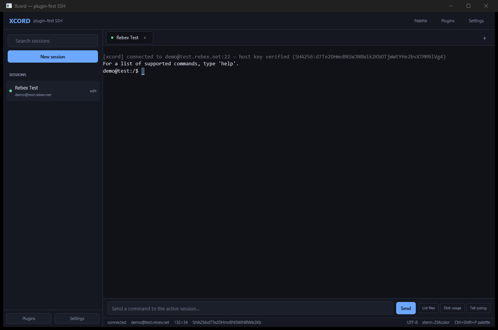

# Xcord

**A plugin-first SSH workspace for Windows, macOS and Linux — written in Rust with GPUI.**

Xcord takes the parts of Xshell that make daily SSH work pleasant (session
management, a real terminal, compose bar, snippets, highlight rules, logging,
keychain-backed credentials) and rebuilds them on an architecture where every
feature is a plugin. The result is a fast native client that is not locked to
one vendor, one OS, or one UI.



> The screenshot above is a live SSH-2 session to `test.rebex.net`, rendered by
> the custom GPUI terminal canvas. Host keys are verified with trust-on-first-use
> and stored in OpenSSH's `known_hosts`.

## Why "everything is a plugin"

Xcord's application kernel is a Rust re-imagining of
[Cordis](https://cordis.js.org/): services, dependency injection, scoped effects,
typed events, and dependency-aware hot reload. The GPUI shell is deliberately
thin — it renders services and forwards user intent.

| Service | Provided by | Responsibility |
|---|---|---|
| `runtime` | `runtime` plugin | Tokio I/O pool + UI post-office bridge |
| `transports` | `transports` plugin | Registry of connection providers |
| `transport:ssh` | `ssh` plugin | SSH-2 via `russh`, host-key verification |
| `sessions` | `sessions` plugin | TOML workspace + platform secret vault |
| `themes` | `themes` plugin | Color schemes for terminal and shell |
| `workspace` | `workspace` plugin | Tabs, terminal emulation, connection lifecycle |
| `highlights` | `highlights` plugin | Regex coloring of output |
| `commands` | `commands` plugin | Command-palette contributions |
| `logging` | `logging` plugin | Per-session log files |
| `ui-host` | **the shell** | Semantic commands from plugins to GPUI |

Plugins declare `inject = ["runtime", "transports"]`; the kernel starts them when
those services exist, unloads dependents when a service disappears, and replays
`apply` on hot reload. Resources are registered as effects and disposed in
reverse order, so unloading cannot leak listeners, tasks, or files.

See [ARCHITECTURE.md](ARCHITECTURE.md) for the full design, a plugin-authoring
guide, the threading model, and the session-open sequence.

## What works today

- **Real SSH-2**: password and public-key auth, PTY request, resize, keepalive,
  optional startup command, TOFU host keys in OpenSSH `known_hosts`.
- **Terminal**: xterm-256color, truecolor, alt screen, scroll regions, SGR,
  wide characters, combining marks, OSC title/clipboard, bracketed paste,
  application cursor keys, scrollback, selection/copy/paste.
- **Session manager**: folders/groups, search, edit/delete, a human-readable
  `config.toml`.
- **Compose bar + snippets**: send a line without touching the shell prompt;
  one-click snippets.
- **Command palette**: every plugin can contribute commands; `Ctrl+Shift+P`.
- **Output highlighting**: regex rules with foreground/background colors,
  shipped with error/warning defaults.
- **Session logging**: opt-in global + per-session logging to `logs/`.
- **Themes**: Xcord Dark, Midnight Blue, Paper Light.
- **Plugin manager**: live plugin states, diagnostics, and hot reload of the
  highlighter.

### Keyboard shortcuts

| Shortcut | Action |
|---|---|
| `Ctrl+Shift+T` | New session |
| `Ctrl+Shift+W` | Close active tab |
| `Ctrl+Tab` / `Ctrl+Shift+Tab` | Next / previous tab |
| `Ctrl+Shift+P` | Command palette |
| `Ctrl+Shift+E` | Focus compose bar |
| `Ctrl+Shift+C` / `Ctrl+Shift+V` | Copy selection / paste |
| `Enter` in compose | Send line |

## Xshell: what we keep, what we fix

| Xshell strength | Xcord |
|---|---|
| Mature session manager | Groups, tags, search, quick connect, plain TOML |
| Great terminal | xterm-256color, truecolor, scrollback, selection |
| Compose bar and quick commands | Compose bar + plugin-provided snippets |
| Highlight rules | Regex rules with live reload |
| Session logging | Opt-in per-session logs |
| Credential management | Windows Credential Manager; portable 0600 fallback elsewhere |

| Xshell weakness | Xcord |
|---|---|
| Windows-only | GPUI targets Windows, macOS and Linux |
| Closed plugin ecosystem | Every feature is a plugin; stable service contracts |
| Dated, dense UI | Clean dark/light themes and a command palette |
| Data lock-in / awkward sync | Plain TOML workspace, no database |
| Monolithic features | Capability plugins, dependency graph, hot reload |

## Build and run

Requirements: a recent stable Rust toolchain (1.89+), a GPU/desktop session, and
the platform dependencies of GPUI. On Windows no extra setup is needed; on Linux
install the usual X11/Wayland development packages.

```bash
cargo run -p xcord
```

The debug build takes a few minutes the first time because GPUI compiles its
renderer. For a smaller, faster binary:

```bash
cargo build --release -p xcord
```

The repository includes a China-friendly crates.io mirror in
`.cargo/config.toml`. Delete that file (or edit the source) to use your default
registry.

### Configuration

- Windows: `%APPDATA%\xcord\config.toml`
- macOS: `~/Library/Application Support/xcord/config.toml`
- Linux: `$XDG_CONFIG_HOME/xcord/config.toml` (or `~/.config/xcord/config.toml`)
- Override with `XCORD_CONFIG_DIR=/path/to/dir`.

Passwords are **never** written to `config.toml`. On Windows they are stored in
Credential Manager under `xcord` / `session:<id>:password`; other platforms
currently use a permission-restricted `secrets.toml` fallback until the native
keychain backend is enabled. `known_hosts` uses the standard OpenSSH file
(`~/.ssh/known_hosts`).

For automation, `XCORD_AUTOCONNECT=<session-id>` connects to a stored session on
launch. It is useful for smoke tests and demos.

### Tests

```bash
cargo test --workspace
```

- `xcord-cordis`: dependency ordering, cascade unload, effect order, event
  scoping, failure cleanup, hot reload.
- `xcord-vt`: text, wrapping, SGR/truecolor, wide chars, scrolling, alt screen,
  resize, OSC, selection, scroll regions.
- `xcord-store`: TOML round-trip, corruption backup, settings.
- `xcord-builtins`: highlighter matching/priority.

There is also an end-to-end SSH probe that speaks to a public test server:

```bash
cargo run -p xcord-ssh --example probe
```

## Project layout

```
crates/
  cordis/       plugin kernel: Context, Plugin, effects, events, lifecycle
  vt/           VT100/xterm terminal emulator and snapshots
  ssh/          russh transport, known_hosts, async session task
  store/        TOML workspace + platform secret vault
  plugin-api/   service contracts shared by plugins and shells
  plugins/      first-party plugins (runtime, ssh, sessions, workspace, ...)
apps/
  xcord/        GPUI shell: sidebar, tabs, terminal canvas, dialogs, palette
docs/
  terminal.png
```

## Security notes

- Host keys are checked against OpenSSH `known_hosts`. The default policy is
  trust-on-first-use: unknown keys are appended, **changed keys are always
  rejected**. Switch to strict mode in Settings.
- Credentials live in Windows Credential Manager (or a `0600` fallback file on
  other platforms). An unsaved password only exists in memory for the lifetime
  of the tab.
- OSC 52 clipboard writes are supported; all other escape sequences are parsed
  locally and never executed.
- Session logs are plain text. Treat them as sensitive.

## Known limitations / roadmap

Xcord is a working foundation, not a finished Xshell replacement. The next
increments are:

- SFTP file browser and transfer queue
- Local/remote/dynamic port forwarding, proxy jumps
- Split panes and a session overview grid
- IME composition in the terminal view (text inputs already use
  `EntityInputHandler`; the terminal currently uses raw key events)
- Search in scrollback, reflow on resize, sixel/kitty graphics
- Xshell `.xsh`/PuTTY import, encrypted workspace sync
- Packaging and code signing

Contributions that add a plugin should only depend on `xcord-cordis` and
`xcord-plugin-api`; the shell does not need to change.

## License

MIT. See [LICENSE-MIT](LICENSE-MIT).
