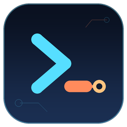
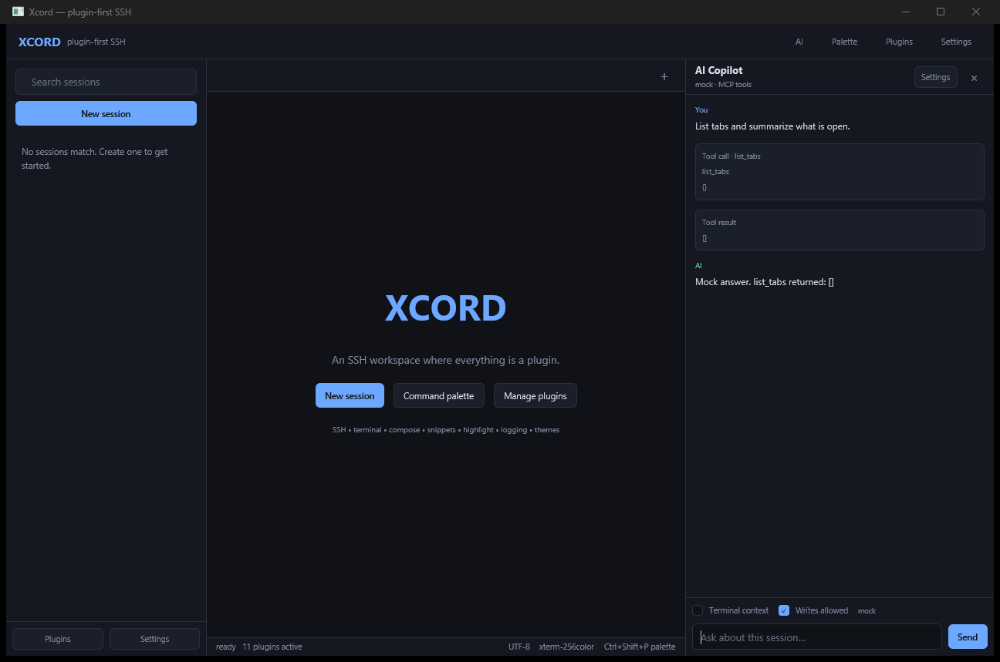
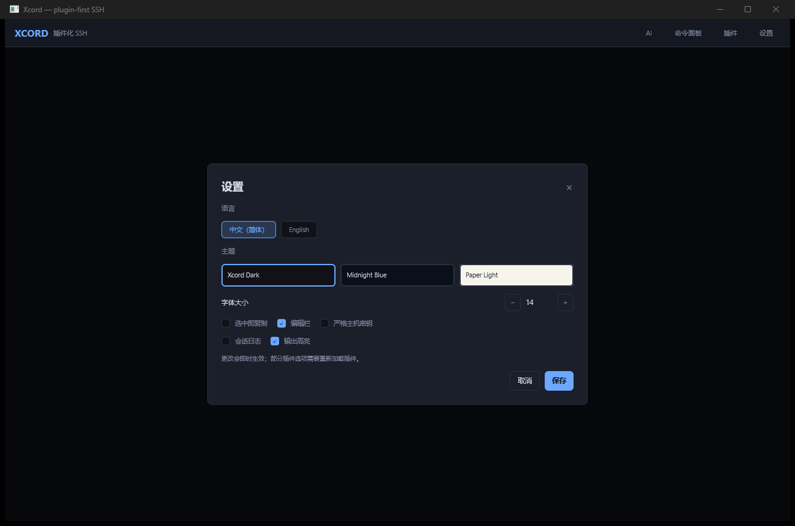
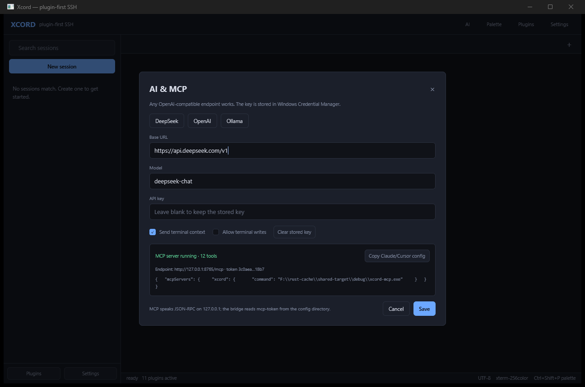

<p align="center"></p>

# Xcord

**A plugin-first SSH workspace for Windows, macOS and Linux — written in Rust with GPUI.**

Xcord takes the parts of Xshell that make daily SSH work pleasant (session
management, a real terminal, compose bar, snippets, highlight rules, logging,
keychain-backed credentials) and rebuilds them on an architecture where every
feature is a plugin. An MCP server exposes the live workspace to AI clients, and
a built-in copilot can inspect terminals and run approved tools.


> The screenshot above is a live SSH-2 session to `test.rebex.net`, rendered by
> the custom GPUI terminal canvas. Host keys are verified with trust-on-first-use
> and stored in OpenSSH's `known_hosts`.



> The copilot streams answers from any OpenAI-compatible endpoint and calls the
> same MCP tools that external clients see. The screenshot uses a local mock
> provider in a repository test; no API key is required to run Xcord.

## Why "everything is a plugin"

Xcord's application kernel is a Rust re-imagining of
[Cordis](https://cordis.js.org/): services, dependency injection, scoped effects,
typed events, and dependency-aware hot reload. The GPUI shell is deliberately
thin — it renders services and forwards user intent.

| Service | Provided by | Responsibility |
|---|---|---|
| `runtime` | `runtime` plugin | Tokio I/O pool + UI post-office bridge |
| `transports` | `transports` plugin | Registry of connection providers |
| `transport:ssh` | `ssh` plugin | SSH-2 via `russh`, host-key verification |
| `sessions` | `sessions` plugin | TOML workspace + platform secret vault |
| `themes` | `themes` plugin | Color schemes for terminal and shell |
| `workspace` | `workspace` plugin | Tabs, terminal emulation, connection lifecycle |
| `highlights` | `highlights` plugin | Regex coloring of output |
| `commands` | `commands` plugin | Command-palette contributions |
| `logging` | `logging` plugin | Per-session log files |
| `i18n` | `i18n` plugin | Locale catalogs shared by shell and plugins |
| `mcp-tools` / `mcp-resources` | `mcp` plugin | Capability registry exposed over MCP |
| `ai` | `ai` plugin | Streaming copilot + tool-calling loop |
| `ui-host` | **the shell** | Semantic commands from plugins to GPUI |

Plugins declare `inject = ["runtime", "transports"]`; the kernel starts them when
those services exist, unloads dependents when a service disappears, and replays
`apply` on hot reload. Resources are registered as effects and disposed in
reverse order, so unloading cannot leak listeners, tasks, or files.

See [ARCHITECTURE.md](ARCHITECTURE.md) for the full design, a plugin-authoring
guide, the threading model, and the session-open sequence.

## What works today

- **Real SSH-2**: password and public-key auth, PTY request, resize, keepalive,
  optional startup command, TOFU host keys in OpenSSH `known_hosts`.
- **Terminal**: xterm-256color, truecolor, alt screen, scroll regions, SGR,
  wide characters, combining marks, OSC title/clipboard, bracketed paste,
  application cursor keys, scrollback, selection/copy/paste.
- **Tab bar**: tabs use the configuration name; repeated connections to one
  profile are auto-numbered (`wsl`, `wsl (2)`, …). Drag tabs left/right to
  reorder, and use the **Group** button to create a session group. Tabs are
  grouped under their session group labels.
- **ZMODEM (`lrzsz`)**: `sz file` downloads automatically into `Downloads`
  (unique names, no overwrite); `rz` opens a multi-file picker and uploads the
  chosen files. Protocol bytes stay out of the terminal, and the SSH stream is
  protected from typing during a transfer.
- **Session manager**: folders/groups, search, edit/delete, a right-click menu
  (edit, duplicate, connect, move to group, new group), drag to reorder sessions
  or drop a session onto a group header, collapsible/expandable groups, group
  rename and drag-to-reorder, a human-readable `config.toml`, a **Browse…** file
  picker for private keys, and a **Test connection** action that verifies SSH
  auth without opening a tab. Duplicating a session creates a new profile with a
  unique auto-numbered name. Double-click a session (or use right-click →
  **Connect**) to open another independent terminal tab for the same profile.
- **Compose bar + snippets**: send a line without touching the shell prompt;
  one-click snippets.
- **Command palette**: every plugin can contribute commands; `Ctrl+Shift+P`.
- **Output highlighting**: regex rules with foreground/background colors,
  shipped with error/warning defaults.
- **Session logging**: opt-in global + per-session logging to `logs/`.
- **Themes**: Xcord Dark, Midnight Blue, Paper Light. Selecting a theme applies
  and persists immediately.
- **Plugin manager**: live plugin states, diagnostics, and hot reload of the
  highlighter.
- **Native packaging**: on Windows the executable uses the GUI subsystem (no
  console window) and embeds the Xcord icon for the taskbar, title bar and
  Explorer.
- **Localization**: Simplified Chinese by default, English available in Settings;
  every plugin can register its own locale catalogs and unregister them on
  unload. Command titles and plugin metadata are localized automatically.
- **MCP server**: 12 tools and 3 resources (plus a terminal template) over
  localhost JSON-RPC, with a stdio bridge for Claude Desktop, Cursor, and other
  MCP clients.
- **AI copilot**: streaming chat, selectable terminal context, auto-scroll, and
  tool calling through the MCP registry. Drag-select text inside any AI message
  and press `Ctrl+C`; if nothing is selected, `Ctrl+C` copies the selected
  message or the full transcript. Right-click any message for a copy menu; each
  message also has a **Copy** button and the header copies the full transcript.
  The chat follows new output until you scroll up; use the right-side timeline
  (↑ last prompt, dots for each prompt, ↓ latest) to jump around. Pick the
  conversation terminal from the chips above the chat; **Follow active tab** is
  the default. It works with OpenAI, DeepSeek, Ollama/vLLM, and any compatible
  endpoint. Terminal writes are blocked unless explicitly enabled.

### Keyboard shortcuts

| Shortcut | Action |
|---|---|
| `Ctrl+Shift+T` | New session |
| `Ctrl+Shift+W` | Close active tab |
| `Ctrl+Tab` / `Ctrl+Shift+Tab` | Next / previous tab |
| `Ctrl+Shift+P` | Command palette |
| `Ctrl+Shift+I` | Toggle AI copilot |
| `Ctrl+Shift+E` | Focus compose bar |
| `Ctrl+Shift+C` / `Ctrl+Shift+V` | Copy selection / paste |
| `Ctrl+C` with a terminal selection | Copy the selected terminal text |
| Right-click a terminal selection | Copy the selected terminal text |
| `Enter` in compose | Send line |
| `Tab` / `Shift+Tab` in a session dialog | Move between fields |
| `Enter` in a session dialog | Save and connect |
| `Ctrl+Enter` in a session dialog | Test the connection |

### ZMODEM / `lrzsz`

Install `lrzsz` on the remote host (`sz`/`rz`). Then:

```bash
sz report.tar.gz      # Xcord downloads into %USERPROFILE%\Downloads
rz -y                 # Xcord opens a file picker and uploads the selection
```

Downloads never overwrite an existing file (`name-1.ext`, `name-2.ext`, …).
The protocol bytes are hidden from the terminal, keyboard input is ignored while
the transfer owns the stream, and cancelling the upload picker aborts the
remote `rz`. Multi-file `sz`/`rz` batches are supported.

## Xshell: what we keep, what we fix

| Xshell strength | Xcord |
|---|---|
| Mature session manager | Groups, tags, search, quick connect, plain TOML |
| Great terminal | xterm-256color, truecolor, scrollback, selection |
| Compose bar and quick commands | Compose bar + plugin-provided snippets |
| Highlight rules | Regex rules with live reload |
| Session logging | Opt-in per-session logs |
| Credential management | Windows Credential Manager; portable 0600 fallback elsewhere |
| Built-in AI / extensibility | MCP server + copilot, every capability is a tool |

| Xshell weakness | Xcord |
|---|---|
| Windows-only | GPUI targets Windows, macOS and Linux |
| Closed plugin ecosystem | Every feature is a plugin; stable service contracts |
| Dated, dense UI | Clean dark/light themes and a command palette |
| Data lock-in / awkward sync | Plain TOML workspace, no database |
| Monolithic features | Capability plugins, dependency graph, hot reload |

## Build and run

Requirements: a recent stable Rust toolchain (1.89+), a GPU/desktop session, and
the platform dependencies of GPUI. On Windows no extra setup is needed; on Linux
install the usual X11/Wayland development packages.

```bash
cargo run -p xcord
```

The debug build takes a few minutes the first time because GPUI compiles its
renderer. For a smaller, faster binary (the MCP bridge is a separate binary in the same
target directory):

```bash
cargo build --release -p xcord -p xcord-mcp
```

The repository includes a China-friendly crates.io mirror in
`.cargo/config.toml`. Delete that file (or edit the source) to use your default
registry.

### Configuration

- Windows: `%APPDATA%\xcord\config.toml`
- macOS: `~/Library/Application Support/xcord/config.toml`
- Linux: `$XDG_CONFIG_HOME/xcord/config.toml` (or `~/.config/xcord/config.toml`)
- Override with `XCORD_CONFIG_DIR=/path/to/dir`.
- `language` defaults to `zh-CN`; set it to `en-US` for English.

Passwords are **never** written to `config.toml`. On Windows they are stored in
Credential Manager under `xcord` / `session:<id>:password`; other platforms
currently use a permission-restricted `secrets.toml` fallback until the native
keychain backend is enabled. `known_hosts` uses the standard OpenSSH file
(`~/.ssh/known_hosts`).

For automation, `XCORD_AUTOCONNECT=<session-id>` connects to a stored session on
launch, and `XCORD_AI_PROMPT="..."` sends a copilot prompt on startup.

### Localization

The UI defaults to **Simplified Chinese**. Switch between `中文（简体）` and
`English` under **Settings → Language**; the choice is stored as
`language = "zh-CN"` / `"en-US"` in `config.toml`, and the window title and input
placeholders update immediately.

Translation catalogs are namespaced by domain and locale. The shell, command
palette, plugin metadata and AI panel use these built-in domains:

| Domain | Contents |
|---|---|
| `app` | shell labels, dialogs, status bar, settings |
| `commands` | command titles keyed by command id |
| `categories` | command categories |
| `plugin` | plugin names/descriptions keyed by plugin id |
| `status` | connection/plugin state labels |

Plugins can contribute their own domain during `apply` and clean it up with a
scoped effect:

```rust
let i18n = ctx.require::<I18n>(services::I18N)?;
let handle = i18n.register_pairs(
    "my-plugin",
    "zh-CN",
    &[("Hello", "你好"), ("{count} files", "{count} 个文件")],
);
ctx.effect("my-plugin translations", move || i18n.unregister(handle));
```

Keys that look like source strings (`"New session"`) fall back to the key itself,
so English needs no separate catalog unless the wording should differ. The
`ai` plugin is a complete example: it registers its own `ai` catalog and uses
`I18n::t`/`t_args` for statuses and errors.



### MCP server and AI copilot

Xcord is also a local MCP capability server. Open **AI → Settings** to see the
endpoint, bridge path, and a ready-to-paste Claude Desktop / Cursor config:

```json
{
  "mcpServers": {
    "xcord": {
      "command": "C:\\path\\to\\xcord-mcp.exe"
    }
  }
}
```



The stdio bridge (`apps/xcord-mcp`) forwards newline-delimited JSON-RPC to
`http://127.0.0.1:8765/mcp` using a per-install bearer token stored in
`%APPDATA%\xcord\mcp-token`. Only localhost is bound.

| MCP tool | Read-only | Purpose |
|---|---|---|
| `list_sessions` | yes | Saved profiles, auth type, whether secrets exist |
| `list_tabs` | yes | Open tabs, status, dimensions, host key |
| `terminal_read` | yes | Scrollback + screen text for a tab |
| `terminal_send` | no | Write input / Enter to a tab |
| `open_session` | no | Open a saved profile with vault credentials |
| `close_tab` | no | Close a tab |
| `select_tab` | yes | Activate a tab |
| `list_plugins` | yes | Plugin graph and states |
| `plugin_diagnostics` | yes | Recent kernel diagnostics |
| `list_commands` | yes | Command-palette entries |
| `run_command` | no | Execute a command by id |
| `get_settings` | yes | Sanitized settings (token removed) |

Resources: `xcord://sessions`, `xcord://tabs`, `xcord://plugins`, plus the
`xcord://terminal/{id}` template. The copilot calls this exact registry, so
external clients and the in-app assistant have identical capabilities.

To use the copilot, open **AI → Settings**, choose a preset (DeepSeek, OpenAI,
Ollama) or enter any OpenAI-compatible base URL, and store an API key in the
platform vault. The key can also come from `XCORD_AI_API_KEY`,
`DEEPSEEK_API_KEY`, or `OPENAI_API_KEY`.

- **Terminal context** sends the selected tab's recent output to the model. Use
  the chips above the chat to pin a tab or follow the active one. Disable it for
  sensitive hosts.
- **Writes blocked** is the default. Enable it only when you want the model to
  call `terminal_send`, `open_session`, `close_tab`, or `run_command`.
- Streaming, tool calls, tool results, and errors appear inline. `Ctrl+Shift+I`
  toggles the panel.

### Tests

```bash
cargo test --workspace
```

- `xcord-cordis`: dependency ordering, cascade unload, effect order, event
  scoping, failure cleanup, hot reload.
- `xcord-vt`: text, wrapping, SGR/truecolor, wide chars, scrolling, alt screen,
  resize, OSC, selection, scroll regions.
- `xcord-store`: TOML round-trip, corruption backup, settings.
- `xcord-builtins`: highlighter matching/priority, OpenAI response/tool parsing,
  UTF-8-safe truncation.
- `xcord-plugin-api`: MCP tool/resource registry registration, dispatch and
  permissions.
- `xcord-builtins` i18n: Chinese defaults, English fallback, plugin catalog
  registration/unregistration.

There is also an end-to-end SSH probe that speaks to a public test server:

```bash
cargo run -p xcord-ssh --example probe
```

## Project layout

```
crates/
  cordis/       plugin kernel: Context, Plugin, effects, events, lifecycle
  vt/           VT100/xterm terminal emulator and snapshots
  ssh/          russh transport, known_hosts, async session task
  store/        TOML workspace + platform secret vault
  plugin-api/   service contracts shared by plugins and shells
  plugins/      first-party plugins (runtime, ssh, sessions, workspace, i18n, mcp, ai, ...)
apps/
  xcord/        GPUI shell: sidebar, tabs, terminal canvas, AI panel, dialogs
  xcord-mcp/    stdio ↔ localhost MCP bridge
docs/
  terminal.png
  ai.png
  ai-settings.png
  settings-language.png
```

## Security notes

- Host keys are checked against OpenSSH `known_hosts`. The default policy is
  trust-on-first-use: unknown keys are appended, **changed keys are always
  rejected**. Switch to strict mode in Settings.
- Credentials live in Windows Credential Manager (or a `0600` fallback file on
  other platforms). An unsaved password only exists in memory for the lifetime
  of the tab.
- OSC 52 clipboard writes are supported; all other escape sequences are parsed
  locally and never executed.
- Session logs are plain text. Treat them as sensitive.
- The MCP endpoint binds to `127.0.0.1` and requires a bearer token. Any local
  process that can read `mcp-token` can drive terminals when the app is running;
  protect the config directory.
- The copilot sends terminal output to the configured provider when **Terminal
  context** is enabled. Tool-driven writes are blocked by default and require an
  explicit toggle.

## Known limitations / roadmap

Xcord is a working foundation, not a finished Xshell replacement. The next
increments are:

- SFTP file browser and transfer queue
- Local/remote/dynamic port forwarding, proxy jumps
- Split panes and a session overview grid
- IME composition in the terminal view (text inputs already use
  `EntityInputHandler`; the terminal currently uses raw key events)
- Search in scrollback, reflow on resize, sixel/kitty graphics
- Per-call AI tool approval, persisted conversations, MCP streamable HTTP/SSE
- Xshell `.xsh`/PuTTY import, encrypted workspace sync
- Packaging and code signing

Contributions that add a plugin should only depend on `xcord-cordis` and
`xcord-plugin-api`; the shell does not need to change.

## License

MIT. See [LICENSE-MIT](LICENSE-MIT).
